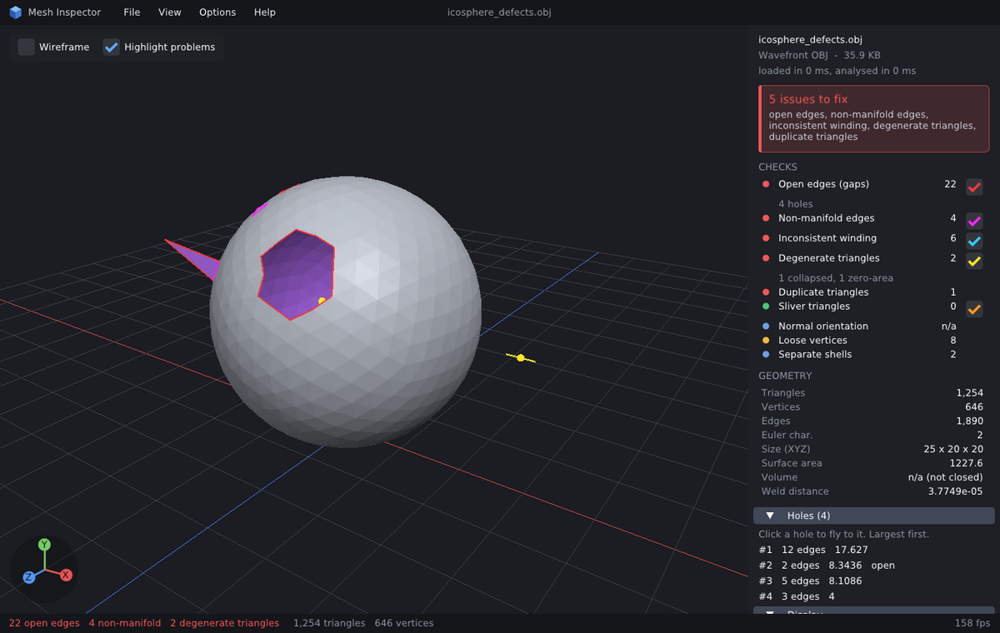

# Mesh Inspector

A small, fast 3D model viewer for **checking the quality of triangle meshes** — open gaps, degenerate
triangles, flipped normals and more — before you print them or feed them to other tools.



It opens the common mesh formats, lets you orbit / pan / zoom around the model, toggle wireframe with a
checkbox, and tells you **how many** problems there are and **where** they are (highlighted right in the 3D view).

> Status: early version (0.1). Windows is the primary target; it also builds on Linux.

## Features

- **Mesh health report** with counts for
  - open edges (gaps) and the number of holes, listed largest first — click a hole to fly the camera to it
  - degenerate triangles (collapsed, zero-area, NaN) and sliver triangles
  - non-manifold edges, duplicate triangles, inconsistent winding (flipped triangles), inverted normals
  - loose vertices, separate shells, Euler characteristic / genus, bounding-box size, surface area, volume
- **Problems highlighted in 3D** — every kind of problem has its own colour and can be toggled
- **Wireframe checkbox**, optional wireframe overlay on the shaded surface, flat or smooth shading, back faces
  shown in a different colour (an easy way to spot inverted normals)
- Orbit / pan / zoom (zoom goes towards the cursor), standard views, orthographic projection, ground grid, axis gizmo
- **Reload (F5)** and optional **auto-reload when the file changes** — handy while you iterate on a generator or exporter
- Drag & drop files onto the window, or pass a file on the command line
- Menus (File / View / Options / Help) live in the title bar, next to the window buttons
- Loads and analyses on a background thread, so big files do not freeze the window

## Supported formats

| Format | Extensions | Notes |
| --- | --- | --- |
| Wavefront OBJ | `.obj` | polygons are triangulated, negative indices supported, optional vertex colours |
| STL | `.stl` | binary and ASCII |
| 3MF | `.3mf` | build transforms, components and multi-file (slicer) packages; colours / materials are ignored |
| PLY | `.ply` | ASCII and binary (little / big endian), vertex colours |
| OFF | `.off` | including `COFF` |
| glTF 2.0 | `.gltf`, `.glb` | node transforms applied; Draco / meshopt compressed files are not supported yet |

Files are shown exactly as stored. For the analysis, vertices at the same position are welded first, so STL
"triangle soup" and OBJ files with split UV seams are checked correctly.

## Building

You need a C++17 compiler, [CMake](https://cmake.org/) 3.16+ and Git. The dependencies
([GLFW](https://www.glfw.org/), [Dear ImGui](https://github.com/ocornut/imgui) and
[cgltf](https://github.com/jkuhlmann/cgltf)) are downloaded automatically by CMake the first time you configure,
so you need an internet connection for that step.

### Windows (Visual Studio)

Install Visual Studio 2019 or 2022 with the **Desktop development with C++** workload (this includes CMake),
plus Git. Then, in a terminal:

```bat
git clone https://github.com/printstudios23-wq/3D-viewer.git
cd 3D-viewer
cmake -S . -B build
cmake --build build --config Release
build\Release\meshinspector.exe samples\icosphere_defects.obj
```

The executable is self-contained (the C++ runtime is linked statically). You can also open the folder in Visual
Studio ("Open a local folder") and let it configure CMake for you.

### Windows (MinGW-w64) / Linux

```sh
cmake -S . -B build -DCMAKE_BUILD_TYPE=Release
cmake --build build
./build/meshinspector samples/icosphere_defects.obj
```

On Linux you need the X11 and OpenGL development packages, e.g. on Debian / Ubuntu:

```sh
sudo apt install build-essential cmake git libx11-dev libxrandr-dev libxinerama-dev libxcursor-dev libxi-dev libgl-dev
```

### Tests

The mesh analysis and the file loaders have unit tests that do not need a GPU or a window:

```sh
ctest --test-dir build -C Release --output-on-failure
```

To build only the library and the tests (no GUI, nothing but cgltf is downloaded):
`cmake -S . -B build -DMESHINSPECTOR_BUILD_APP=OFF`.

## Using it

Open a file with **File > Open** (`Ctrl+O`), drop it onto the window, or run `meshinspector <file>`.

| Action | Control |
| --- | --- |
| Orbit | left mouse drag |
| Pan | right or middle drag, or `Shift` + left drag |
| Zoom | mouse wheel (towards the cursor), or `Ctrl` + left drag |
| Frame the model | `F` or double-click |
| Reset view | `Home` |
| Wireframe | `W` or the **Wireframe** checkbox |
| Grid | `G` |
| Front / back / left / right / top / bottom | `1` `2` `3` `4` `5` `6` |
| Show / hide the report panel | `Tab` |
| Hide / show the whole interface | `H` (or `Esc` to show it again) |
| Reload | `F5` |

Your settings (colours, display options, up axis, analysis thresholds, window size) are saved automatically and restored
the next time you start the program. They live in `%APPDATA%\MeshInspector\settings.ini` (`~/.config/meshinspector/`
on Linux). Delete that file, or start with `meshinspector --reset-settings`, to go back to the defaults.

If the custom title bar ever misbehaves on your system, start the program with `meshinspector --native-frame` to get the
normal Windows title bar (the menus then sit just below it).

**Hide the interface:** press `H` (or **View > Hide interface**) to get a clean view of just the model; `H` or `Esc`
brings the interface back.

**Up axis:** models are shown Z-up by default (the STL / CAD / slicer convention). glTF and most OBJ files use +Y as
up, so if one of those lies on its back, switch **Options > Up axis**.

## What the checks mean

| Check | Meaning | For 3D printing |
| --- | --- | --- |
| Open edges | An edge used by only one triangle. Open edges mean the surface has holes. | must be 0 (watertight) |
| Non-manifold edges | An edge shared by three or more triangles. | must be 0 |
| Inconsistent winding | Two neighbouring triangles disagree about which side is outside. | must be 0 |
| Degenerate triangles | Zero area: two corners at the same point, three collinear corners, or NaN coordinates. "Thinner than the weld distance" counts as zero. | should be 0 |
| Duplicate triangles | The same triangle stored more than once. | should be 0 |
| Normal orientation | Judged from the signed volume of a closed mesh. "Inverted" means the triangles are wound inside-out. | must be outward |
| Sliver triangles | Triangles with a very small angle (default below 1°). Informational. | usually harmless |
| Loose vertices | Points that no triangle uses. | harmless, but wasteful |
| Separate shells | Number of disconnected pieces. | expected to match your design |

The weld distance and the sliver angle can be changed in **Options > Mesh analysis**.

Not checked yet: self-intersections and wall thickness.

## Samples

The `samples/` folder contains a clean sphere (`icosphere_clean.obj` / `.stl`) and `icosphere_defects.obj`, which has
holes, flipped and duplicate triangles, degenerate triangles and a non-manifold fin on purpose. They are produced by
`samples/generate_samples.py`.

## Project layout

```
src/analysis.*      mesh analysis (welding, topology, triangle quality)
src/loaders/        OBJ, STL, 3MF (with its own ZIP/inflate), PLY, OFF and glTF readers
src/mesh_io.*       picks the loader from the file extension
src/renderer.*      OpenGL 3.3 rendering (surface, wireframe, problem overlays, grid)
src/camera.*        orbit camera
src/app.*, ui.cpp   window, input, background loading, Dear ImGui interface
src/platform_*.cpp  native file dialog and the custom title bar on Windows
tests/              unit tests (no GPU needed)
```

The analysis and loader code (`meshinspector_core`) has no GUI or OpenGL dependency, so it can be reused or tested on its own.

## Ideas for later

- self-intersection and minimum wall thickness checks, automatic repair (fill holes, fix winding, remove degenerate triangles)
- FBX support, 3MF colours / materials, texture display, Draco compressed glTF
- export of the cleaned mesh, side-by-side comparison of two files
- remember window and options between runs, recent files
- keyboard-accessible menus

Contributions are welcome — please open an issue or a pull request.

## License

Licensed under the [Apache License 2.0](LICENSE). Third-party components are listed in
[THIRD_PARTY_NOTICES.md](THIRD_PARTY_NOTICES.md).
